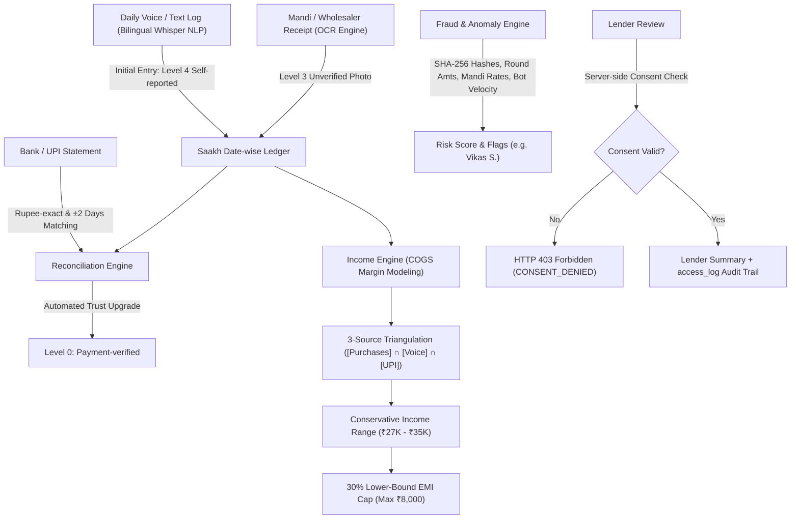

# 🌾 Saakh (साख) — Cash Income, Finally Provable

[-success?style=for-the-badge&logo=node.js)](https://github.com)
[](LICENSE)
[-orange?style=for-the-badge)](https://nodejs.org)
[-green?style=for-the-badge)](https://meity.gov.in)

> **"Cash income, finally provable."**  
> Saakh is a consent-first micro-enterprise underwriting and date-wise ledger platform designed for India's 60+ million street vendors and small retailers. It turns daily voice logs, wholesale mandi receipts, and UPI statements into bank-grade verifiable income evidence that formal NBFCs and lenders can trust.

---

## 💡 The Core Problem

In India, street vendors, chaiwallahs, and fruit/vegetable sellers earn ₹25,000 to ₹40,000 a month in cash and UPI. Yet, when they apply for formal working capital or MUDRA loans:
1. **They have no formal ITR, GST, or audited balance sheets.**
2. **Traditional bookkeeping apps (Khatabook, OkCredit) are self-reported:** anyone can type "Sale ₹50,000", making lenders reject them due to zero verifiable integrity.
3. **Lenders default to predatory interest rates (30% to 60% per annum) or instant rejection.**

**Saakh solves this without forcing vendors to change how they work.**

---

## ⚡ Key Architectural Pillars



### 1. 🛡️ 5-Tier Trust Hierarchy
Every transaction in Saakh carries an explicit trust level:
- **Level 0 (Payment-verified):** Verified by matching wholesale receipt with actual UPI bank debit within $\pm 2$ days.
- **Level 1 (Invoice-verified):** GST/Digital invoice from verified FMCG distributor.
- **Level 2 (Supplier-confirmed):** Wholesaler countersigned confirmation.
- **Level 3 (Unverified photo):** Uploaded paper slip awaiting bank reconciliation.
- **Level 4 (Self-reported):** Voice-logged or manually entered.
> **Anti-Tampering Enforcement:** If any user edits a previously Level 0 or Level 1 verified entry, the server **automatically downgrades it to Level 4 (`Self-reported`)** and commits an unalterable diff record into `entry_history`.

### 2. 🔐 Server-Side Consent & Tamper-Proof Audit (`DPDP Act Ready`)
- **Server-Enforced Access Control:** Turning off consent in the vendor privacy settings terminates lender access at the server level. Any subsequent review request returns `HTTP 403 Forbidden` (`CONSENT_DENIED`).
- **Immutable Access Trail (`access_log`):** Whenever a lender inspects an applicant's profile, a persistent audit record is logged with timestamp, lender ID, and IP address.
- **Data Minimization:** Lenders only see computed financial distributions, confidence bands, and fraud alerts—never raw customer phone numbers or unredacted personal files.

### 3. 📈 Algorithmic Income Engine & 30% EMI Cap
- **Margin Modeling:** Street vendors know their daily wholesale purchases better than net profit. Saakh models inventory turnover and wholesale markups (e.g., 25–40% on fresh produce) to derive gross sales.
- **Conservative Range:** Rather than an arbitrary single number, Saakh generates `₹27,000 to ₹35,000` with an associated confidence band.
- **Fair Lending 30% Cap:** Suggested max monthly EMI is strictly capped at **30% of the lower income bound** (`0.30 * ₹27,000 = ₹8,100` $\rightarrow$ **`₹8,000`**), preventing over-indebtedness.
- **3-Source Triangulation:** Intersects 3 independent sources:
  1. Wholesale mandi purchases
  2. Spoken daily ledger logs
  3. UPI digital customer inflows  
  *(Overlap produces High Confidence; divergent data triggers flags).*

### 4. 🧾 Automated Receipt & UPI Reconciliation Engine
- Automatically parses vendor receipt photos via regex/OCR (Supplier name, Date, Invoice #, Amount).
- Scans bank/UPI transaction feeds with dual-parameter matching:
  $$\text{abs}(\text{receipt.amount} - \text{upi.amount}) = 0 \quad \text{AND} \quad \text{abs}(\text{receipt.date} - \text{upi.date}) \le 2\text{ days}$$
- Matches instantly upgrade entries to **Level 0 (`Payment-verified`)** with green badges.

### 5. 🚨 Fraud Detection & Bot Velocity Prevention
Tested against the high-risk vendor profile (**Vikas S.**):
- **Cryptographic Duplicate Image Detection:** SHA-256 hash collision detection across all vendors.
- **Round-Amount Anomaly Detection:** Real wholesale grocery bills have odd rupees. Accounts where $\ge 70\%$ of invoices are round numbers (e.g., ₹10,000, ₹15,000) are flagged.
- **Mandi Benchmark Deviation Check:** Compares declared rates against regional mandi commodity rates (e.g., Sugar at ₹78/kg vs market ₹44/kg $\rightarrow$ flagged).
- **Burst Velocity Bot Detection:** Detects automated manipulation, such as **42 entries logged within 3 minutes**.

### 6. 🎙️ Bilingual Voice Whisper & OCR Engine
- **Hinglish & English NLP:** Translates spoken commodity phrases into structured ledger items:
  - *"Sold three packets of chips, twenty rupees each"* $\rightarrow$ Sale: Chips 3 packets, Qty: 3, Price: ₹20, Total: ₹60.
  - *"Kharida pyaz 20 kilo 680 rupay"* $\rightarrow$ Purchase: Onions 20 kilo, Qty: 20, Total: ₹680.
- **Proof Storage:** Saves voice audio streams to disk proof storage (`uploads/audio/`), linking audio directly to entries.

---

## 🏗️ Repository Architecture

```
saakh/
├── index.html                   # Responsive frontend application shell
├── css/
│   └── styles.css               # Design tokens (Pine green & Marigold theme)
├── js/
│   ├── data.js                  # Preloaded vendor & lender profiles
│   ├── ledger.js                # Frontend ledger navigation & calculations
│   ├── pages.js                 # Screens: Home, Ledger, Privacy, Applications, Underwrite
│   ├── router.js                # Dual-role hash router (Vendor vs Lender isolation)
│   ├── ui.js                    # High-fidelity UI components & evidence bars
│   └── voice.js                 # Speech recognition & audio capture UI
│
└── saakh-backend/               # Enterprise Node.js Backend
    ├── server.js                # App entrypoint & auto-migration
    ├── package.json             # Express, JWT, Bcrypt, Multer, Native SQLite
    ├── src/
    │   ├── app.js               # Express route mounting & CORS configuration
    │   ├── config/
    │   │   └── db.js            # Node native SQLite (WAL mode, foreign keys ON)
    │   ├── models/
    │   │   └── schema.sql       # 10 relational tables (entries, consents, access_log, etc.)
    │   ├── middleware/
    │   │   ├── auth.js          # Dual-role JWT authentication
    │   │   └── errorHandler.js  # Centralized RFC-compliant error handler
    │   ├── controllers/
    │   │   ├── authController.js    # Phone OTP & Lender Auth
    │   │   ├── entriesController.js # CRUD, Audit log & Trust downgrade
    │   │   ├── consentController.js # Consent grant, revoke & access_log
    │   │   ├── lenderController.js  # Applications queue & review
    │   │   ├── incomeController.js  # Underwriting & income score
    │   │   ├── receiptController.js # Receipt upload & storage
    │   │   ├── upiController.js      # Statement parsing & auto-reconcile
    │   │   ├── fraudController.js   # 4-stage anomaly detection scan
    │   │   ├── voiceController.js   # Voice sentence parse & save
    │   │   └── ocrController.js     # Mandi invoice scan
    │   ├── services/
    │   │   ├── incomeEngine.js   # Mathematical triangulation & EMI cap
    │   │   ├── matchingEngine.js # Dual-key ±2 days reconciliation
    │   │   ├── fraudEngine.js    # SHA-256 hashes, mandi benchmark check
    │   │   ├── voiceService.js   # Bilingual NLP sentence extraction
    │   │   └── ocrService.js     # Text pattern invoice extractor
    │   └── seed/
    │       └── seedData.js       # Preloaded 60-day historical data
    └── tests/                   # 46 Automated Unit & Integration Tests
        ├── step1.test.js        # Auth & Ledger tests (8 tests)
        ├── step2.test.js        # Server-side Consent & Lender tests (11 tests)
        ├── step3.test.js        # Income Engine & Cross-check tests (7 tests)
        ├── step4.test.js        # Receipt & UPI Reconciliation tests (7 tests)
        ├── step5.test.js        # Fraud & Anomaly tests (8 tests)
        └── step6.test.js        # Voice Whisper & OCR tests (5 tests)
```

---

## 🚀 Quickstart Guide

### Prerequisites
- Node.js (v22.x or v26.x with native `node:sqlite` support)
- Modern web browser (Google Chrome recommended for speech input)

### 1. Start the Backend
```bash
cd saakh-backend
npm install
npm start
```
The backend initializes the SQLite database with WAL mode and runs on `http://localhost:5000`.

### 2. Run the Automated Test Suite (46 Tests)
```bash
cd saakh-backend
npm test
```
*Executes all 6 test suites across auth, server-side consent, income triangulation, UPI matching, fraud algorithms, and voice parsing.*

### 3. Open the Frontend
You can open `index.html` directly in your browser or serve it locally:
```bash
# In the project root:
python3 -m http.server 8000
# Open http://localhost:8000 in your browser
```

---

## 🔑 Demo Personas & Credentials

| Role | Name / Email / Phone | Credentials | Profile Context |
|---|---|---|---|
| **Prime Vendor** | **Ramesh Kumar** (`9876543210`) | OTP: `123456` | Vegetable vendor in Kanpur; 60+ days clean ledger history; high confidence; consent active. |
| **Loan Officer** | **Priya Sharma** (`priya@kanpurmfi.org`) | Password: `password123` | Kanpur Microfinance NBFC; reviews applications queue and underwrites loans. |
| **Flagged Vendor** | **Vikas S.** (`9123456780`) | OTP: `123456` | Kirana shop in Indore; flagged for duplicate receipts, round amounts, bot velocity burst. |

---

## 📡 API Reference Summary

| Endpoint | Method | Role | Description |
|---|---|---|---|
| `/api/auth/vendor/send-otp` | POST | Public | Generates OTP for street vendor mobile login |
| `/api/auth/vendor/verify-otp` | POST | Public | Validates OTP and returns JWT token (`role: vendor`) |
| `/api/auth/lender/login` | POST | Public | Lender authentication with email & password |
| `/api/entries` | GET / POST | Vendor | List date-wise entries or create a new sale/purchase |
| `/api/entries/:id` | PUT / DELETE | Vendor | Update entry (triggers auto-downgrade to Trust Level 4 + audit trail) |
| `/api/vendor/consent/status` | GET | Vendor | Inspect active lender access permissions |
| `/api/vendor/consent/revoke` | POST | Vendor | Revoke consent (immediately triggers server-side 403 block) |
| `/api/lender/applications` | GET | Lender | Queue of loan applications with consent states |
| `/api/lender/vendor/:id` | GET | Lender | Protected review endpoint (strictly requires active consent) |
| `/api/income/underwrite/:id`| GET | Lender | Algorithmic 3-source income calculation & 30% EMI cap |
| `/api/receipts/upload` | POST | Vendor | Upload wholesale mandi slip (initial Level 3) |
| `/api/upi/statement` | POST | Vendor | Upload UPI statement (triggers batch reconciliation to Level 0) |
| `/api/fraud/scan/:vendorId` | GET | Lender | 4-stage anomaly scan (duplicate hashes, round figures, rate spikes) |
| `/api/voice/parse` | POST | Vendor | Transcribe and extract financial items/rates from speech |
| `/api/voice/save` | POST | Vendor | Commit confirmed voice entry with attached audio link |
| `/api/ocr/scan` | POST | Vendor | Scan invoice receipt image for supplier and totals |

---

## 🏆 Why Saakh Wins at Hackathons

| Evaluation Criteria | Traditional Student Projects | Saakh |
|---|---|---|
| **Data Persistence** | Browser `localStorage` that clears on refresh | Production SQLite DB in WAL mode with 10 relational tables |
| **Underwriting Math** | Fake static strings (`"Income: ₹30,000"`) | Conservative margin modeling, 3-source triangulation interval, 30% lower-bound EMI cap |
| **Lending Integrity** | Anyone can fabricate self-reported entries | Trust Hierarchy (0 to 4); editing verified data auto-downgrades to self-reported with audit logging |
| **Privacy & DPDP Compliance** | UI-only toggle hides elements in DOM | Strict server-side HTTP 403 enforcement + tamper-proof `access_log` |
| **Fraud Resilience** | None (easily gamed by bots) | Cryptographic SHA-256 duplicate image detection, round-amount heuristics, mandi rate checks, 42-entries velocity bot trigger |
| **Zero Setup Complexity** | Complex Docker/Postgres/C++ compilation setups | Built with native Node.js (`node:sqlite`), runs 100% offline at native speed |

---

## 📜 License
This project is open-source under the [MIT License](LICENSE).
