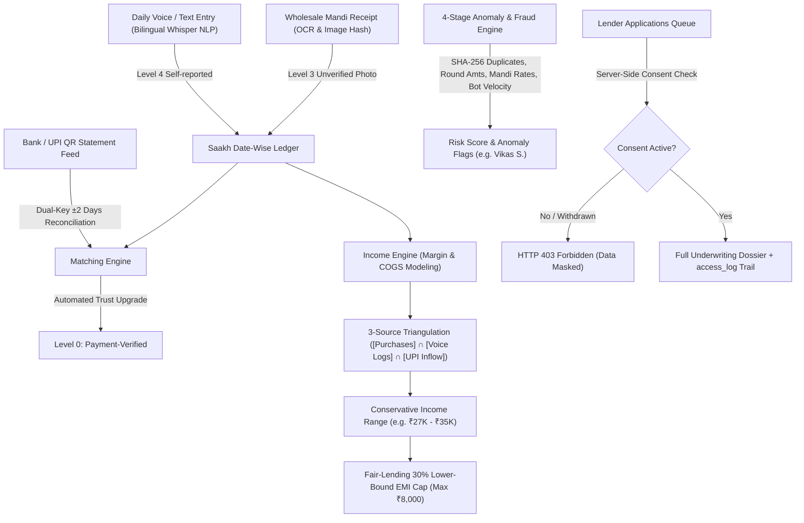

# 🌾 Saakh (साख) — Cash Income, Finally Provable

[-success?style=for-the-badge&logo=node.js)](https://github.com)
[](LICENSE)
[-orange?style=for-the-badge)](https://nodejs.org)
[-green?style=for-the-badge)](https://meity.gov.in)
[](https://2factor.in)
[-teal?style=for-the-badge)](https://github.com)

> **"Cash income, finally provable."**  
> Saakh is a consent-first micro-enterprise underwriting and date-wise financial ledger platform designed for India's 60+ million street vendors, kirana merchants, and nano-retailers. It turns daily voice logs, wholesale mandi receipts, utility payments, and UPI statements into bank-grade, tamper-evident income evidence that formal NBFCs and microfinance lenders can underwrite with high confidence.

---

## 💡 The Problem & The Solution

In India, street vendors, small tea stalls, and vegetable retailers earn ₹25,000 to ₹50,000 monthly, predominantly in cash and QR payments. However, when applying for working capital or PM SVANidhi loans:
1. **They lack formal ITRs, GST registrations, or audited balance sheets.**
2. **Traditional bookkeeping apps (Khatabook, OkCredit) are 100% self-reported:** anyone can type "Sale ₹50,000" without proof, leading lenders to discard digital logs as unverifiable.
3. **Lenders default to predatory informal loans (30% to 60% per annum) or flat rejection.**

**Saakh bridges this gap with verifiable evidence levels, mathematical triangulation, and consent-driven transparency—without disrupting how vendors run their daily businesses.**

---

## ⚡ Architectural Blueprint



---

## 🌟 Key Features & Innovations

### 1. 🛡️ 5-Tier Verifiable Trust Hierarchy
Every transaction in the ledger carries an explicit, auditable trust level:
- **Level 0 (Payment-verified):** Verified by matching wholesale receipt directly with bank UPI debit records within $\pm 2$ days.
- **Level 1 (Invoice-verified):** Formal GST or distributor bill from verified FMCG wholesalers.
- **Level 2 (Supplier-confirmed):** Confirmed by regular market suppliers.
- **Level 3 (Unverified photo):** Uploaded paper slip or receipt photo awaiting matching.
- **Level 4 (Self-reported):** Voice-logged or manually entered transaction.
> **Anti-Tampering Integrity:** If an existing Level 0 or Level 1 verified entry is modified, the system **automatically downgrades it to Level 4 (`Edited by you`)** and commits an unalterable diff record into `entry_history`.

---

### 2. 📱 Dual Authentication & Live SMS Gateway
- **Real Vendor Authentication:** Vendors authenticate via their 10-digit mobile number with **live SMS OTP dispatch** powered by **2Factor.in** (`TWOFACTOR_API_KEY`).
  - Cryptographically secure 6-digit OTPs hashed with SHA-256 in SQLite.
  - 30-second cooldown protection.
  - 5-attempt rate-limiting lockout against brute-force attacks.
  - Zero OTP exposure in client responses.
- **1-Click Lender Demo Mode:** Pre-populated credentials (`priya@kanpurmfi.org` / `password123`) for Loan Officer Priya Sharma at Kanpur Microfinance with 1-click **"Verify and continue"** access into the review dashboard.
- **Strict Role Separation:** Vendor data is real and dynamically user-isolated; lender queue serves review pipelines with zero cross-contamination.

---

### 3. 📅 Date-Wise Ledger History & Inline Editing
- **Full Historical Browsing:** Automatically discovers and lists all dates from the vendor's registration date up to today.
- **Flexible Navigation:** Jump between dates via the daily ledger list, monthly summaries, or the calendar date picker.
- **Live Inline Editing & Deletion:** Edit Item Name, Type (Sale/Purchase), or Amount on any past or present date with instant recalculation of daily sales, purchases, and estimated profit.
- **Dual Persistence:** Automatically persisted in browser `localStorage` and synchronized asynchronously with SQLite backend tables (`/api/entries`).

---

### 4. 🔗 Dynamic Data Sources (UPI, Receipts, Utility, SHG)
Real vendor accounts start with clean, dynamic data sources that can be linked via interactive modals:
- **Voice Sales Log:** Real-time badge tracking today's confirmed voice sales.
- **Wholesale Receipts:** Upload wholesale mandi purchase bills; automatically updates verified count and adds purchase entries.
- **UPI Statement:** Link business UPI VPA (e.g. `phone@paytm`, `shop@okhdfcbank`) and bank to reconcile customer QR payments.
- **Utility Bills:** Connect electricity account (UPPCL, BSES, etc.) to establish proof of fixed operating location and 100% on-time utility discipline.
- **Self-Help Group (SHG):** Link SHG or Mahila Bachat Samuh membership, monthly savings, and tenure—a strong positive proxy for microfinance underwriting.

---

### 5. 📈 Conservative Income Modeling & 30% EMI Cap
- **Margin Triangulation:** Calculates conservative monthly income bounds using wholesale turnover markups, voice sales logs, and UPI inflows.
- **30% Fair-Lending Cap:** Max suggested monthly EMI is hard-capped at **30% of the lower income bound** (`0.30 × Lower Bound`), preventing predatory over-indebtedness.
- **3-Source Overlap:** When all three sources converge, confidence is rated **High**; divergence lowers confidence and alerts the loan officer.

---

### 6. 🚨 4-Stage Fraud & Anomaly Engine
Underwriters can inspect risk flags across 4 heuristic algorithms (demonstrated on high-risk profile **Vikas S.**):
1. **Cryptographic Duplicate Bill Detection:** Computes SHA-256 image hashes to detect recycled bills across vendors.
2. **Round-Number Anomaly:** Detects fabricated books where $\ge 70\%$ of invoices are round amounts (e.g. ₹10,000, ₹15,000).
3. **Mandi Benchmark Check:** Compares declared rates against regional mandi price benchmarks (e.g., Sugar at ₹78/kg vs market ₹44/kg $\rightarrow$ flagged).
4. **Burst Velocity Bot Detection:** Flags automated bulk manipulation (e.g., 42 voice entries recorded within 3 minutes).

---

### 7. 🌐 Complete Bilingual Support (English & Hindi)
- Fully accessible bilingual experience covering all pages, forms, modals, error messages, voice parsing, and ledger views.
- Clean language toggle situated exclusively on the top-right navigation bar.

---

## 🏗️ Repository Structure

```
Saakh/
├── index.html                   # Single-Page Application shell
├── css/
│   └── styles.css               # Material 3 Design tokens & palette
├── js/
│   ├── auth.js                  # 2Factor SMS OTP, digit auto-navigation & lender login
│   ├── data.js                  # User data sources, dynamic state & interactive modals
│   ├── i18n.js                  # Bilingual translation dictionary & reactive switch
│   ├── ledger.js                # Date-wise ledger history, inline editor & totals
│   ├── pages.js                 # Screens: Home, Ledger, Score, Privacy, Applications
│   ├── router.js                # Dual-role hash router & auth guards
│   ├── ui.js                    # Reusable components, modals, evidence bars
│   ├── utils.js                 # Currency formatters, DOM helpers & date math
│   └── voice.js                 # Bilingual speech recognition & audio parser
│
└── saakh-backend/               # Node.js + Express Backend
    ├── server.js                # Server entrypoint (serves backend & frontend on :5000)
    ├── package.json             # Express, JWT, Bcrypt, Multer, Native SQLite
    ├── .env.example             # Gateway API keys & configuration template
    ├── src/
    │   ├── app.js               # Route mounting, static frontend serving & CORS
    │   ├── config/
    │   │   └── db.js            # Node native SQLite (WAL mode, foreign keys ON)
    │   ├── models/
    │   │   └── schema.sql       # 10 relational tables (entries, consents, access_log, etc.)
    │   ├── middleware/
    │   │   ├── auth.js          # Dual-role JWT authentication
    │   │   └── errorHandler.js  # RFC-compliant error handling
    │   ├── controllers/         # Modular controllers (auth, entries, consent, income, etc.)
    │   ├── services/
    │   │   ├── incomeEngine.js  # Triangulation algorithm & 30% EMI cap
    │   │   ├── matchingEngine.js# Dual-key ±2 days reconciliation
    │   │   ├── fraudEngine.js   # SHA-256 collision, round figures, mandi benchmarks
    │   │   ├── smsService.js    # 2Factor.in live SMS gateway + mock driver
    │   │   └── voiceService.js  # NLP sentence extraction
    │   ├── utils/
    │   │   └── i18n.js          # Backend bilingual error & response middleware
    │   └── seed/
    │       └── seedData.js      # Idempotent demo database seeder
    └── tests/                   # 74 Automated Test Cases Across 8 Suites
        ├── step1.test.js        # Unit & Database CRUD (8 tests)
        ├── step2.test.js        # Server-Side Consent & Lenders (11 tests)
        ├── step3.test.js        # Income Engine & Cross-Checks (7 tests)
        ├── step4.test.js        # Receipt & UPI Reconciliation (7 tests)
        ├── step5.test.js        # Fraud & Anomaly Algorithms (6 tests)
        ├── step6.test.js        # OCR & Text Extraction (5 tests)
        ├── i18n.test.js         # Bilingual Hindi/English Integration (19 tests)
        └── sms_otp.test.js      # SMS OTP Gateway & Security Flow (9 tests)
```

---

## 🚀 Getting Started

### Prerequisites
- **Node.js** v22.x or v26.x (with native `node:sqlite` support)
- Modern web browser (Google Chrome recommended for Web Speech API)

### 1. Clone & Setup
```bash
git clone https://github.com/aasthajain1017-lang/Saakh.git
cd Saakh/saakh-backend
npm install
```

### 2. Configure Environment Variables
Create `.env` in `saakh-backend/`:
```env
PORT=5000
NODE_ENV=development
JWT_SECRET=saakh_production_jwt_secret_key_2026_xyz987
OTP_EXPIRY_MINUTES=10

# SMS Gateway (Choose live 2factor or mock for local development)
SMS_PROVIDER=2factor
TWOFACTOR_API_KEY=your_2factor_api_key_here
TWOFACTOR_SENDER_ID=SAAKHN
```

### 3. Run Server
```bash
npm start
```
The server starts on **`http://localhost:5000`** and serves both the backend API and frontend SPA.

### 4. Run Automated Test Suite (74 Tests)
```bash
npm test
```
All 74 tests across 8 test suites will execute and pass 100%.

---

## 🔑 Login Personas & Test Credentials

| Persona | Role | Credentials | Description |
|:---|:---|:---|:---|
| **Real Vendor** | Vendor | Enter registered 10-digit mobile number | Receives real live SMS OTP via 2Factor; personalized clean ledger and dynamic data sources. |
| **Demo Vendor (Ramesh Kumar)** | Vendor | Phone: `1234567890`<br>Fixed OTP: `123456` | Pre-populated 60-day historical ledger, verified receipts, and high-confidence score. |
| **Loan Officer (Priya Sharma)** | Lender | Email: `priya@kanpurmfi.org`<br>Password: `password123` | Click **"Verify and continue"** on the *"I'm a lender"* tab to review active vendor applications. |
| **Flagged Profile (Vikas S.)** | Vendor (Risk Review) | Profile accessible in Lender queue | Highlights duplicate receipt collisions, round numbers, and velocity bot anomalies. |

---

## 📡 API Overview

| Route | Method | Access | Purpose |
|:---|:---:|:---:|:---|
| `/api/health` | GET | Public | Service health & database connectivity check |
| `/api/auth/vendor/send-otp` | POST | Public | Dispatches 6-digit SMS OTP with cooldown |
| `/api/auth/vendor/verify-otp` | POST | Public | Validates OTP and issues Vendor JWT |
| `/api/auth/lender/login` | POST | Public | Authenticates lender with email & password |
| `/api/entries` | GET / POST | Vendor | Retrieve date-wise ledger or add manual entry |
| `/api/entries/:id` | PUT / DELETE | Vendor | Updates entry (triggers auto-downgrade to Level 4) |
| `/api/receipts/upload` | POST | Vendor | Uploads purchase bill (initial Level 3) |
| `/api/upi/statement` | POST | Vendor | Ingests statement transactions and triggers matching |
| `/api/vendor/consent/status` | GET | Vendor | Inspects active lender permissions |
| `/api/vendor/consent/revoke` | POST | Vendor | Instantly terminates lender access (HTTP 403) |
| `/api/lender/applications` | GET | Lender | Queue of loan applications with consent states |
| `/api/lender/vendor/:id` | GET | Lender | Full underwriting review (strictly consent-gated) |
| `/api/fraud/scan/:vendorId` | GET | Lender | Runs 4-stage heuristic anomaly detection scan |

---

## 📜 License
This project is open-source under the [MIT License](LICENSE).
